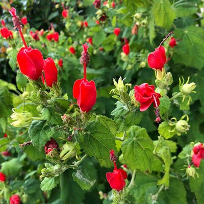
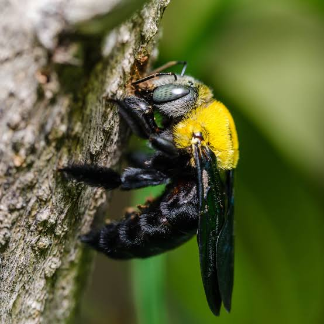
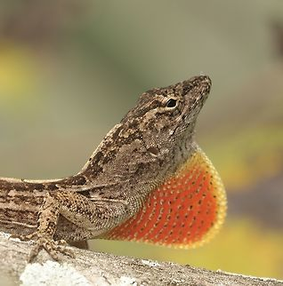
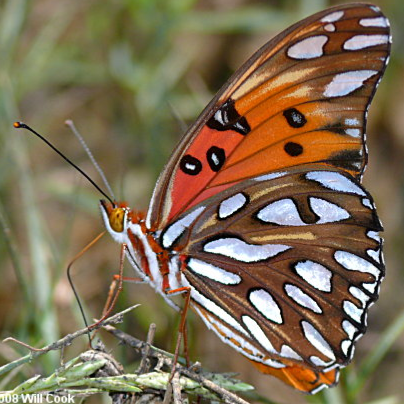

:::background overlay=dark opacity=0
:::
:::

:::text x=3.8% y=74% width=90.2% size=54 color=#fa4b00 align=right
**Classroom Slideshow Template**
:::
---

:::center
# NEW LESSON
:::

:::list columns=3 widths=3 align=center
1. **Observe** — Look closely at the example.
2. **Ask** — Write a question.
3. **Predict** — Explain what you expect.
4. **Test** — Try your idea.
5. **Record** — Capture your evidence.
6. **Reflect** — Explain what changed.
:::
---

:::text x=5.4% y=20.4% width=33.2% size=34 color=#175A80
# Wildlife Images
:::

:::list columns=2 align=right widths=4 number-size=32 gap=small
- 
- 
- 
- 

:::
---

:::background

:::

:::text x=66.2% y=8.6% width=30.3% size=34 color=#175A80 align=left
# Investigate
:::

:::text x=66.1% y=26.7% width=30.9% size=23 color=#172C3B align=left
- Observe the example.
- Test one idea.
- Record your evidence.
:::

:::notes
Materials and teacher reminders go here.
:::

---

# Reflect

| Header 1 | Header 2 | Header 3 |
| --- | --- | --- |
|  |  |  |
|  |  |  |
|  |  |  |

