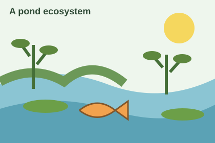

# Observe a pond

Living things and their surroundings

:::notes
Ask students what they have noticed near ponds or streams.
:::

---

# Learning objective

Identify living and nonliving parts of an ecosystem.

- Observe an environment closely.
- Sort examples using evidence.
- Explain how two parts interact.

---

# Living and nonliving

:::columns
:::column

## Living things

- Plants
- Animals
- Fungi

:::column

## Nonliving surroundings

- Water
- Sunlight
- Rocks
:::

---

# Observe the pond

:::columns
:::column
Find two living things and two nonliving parts of this environment.

Explain one interaction you can see or infer.

:::column

:::

:::notes
Give students a minute to observe before sharing. Ask what evidence supports each classification.
:::

---

# Build an explanation

1. Choose one living thing.
2. Identify something it needs from its surroundings.
3. Explain how a change could affect it.

---

# Exit ticket

Describe one interaction between a living thing and its nonliving surroundings.

Include an observation that supports your explanation.
